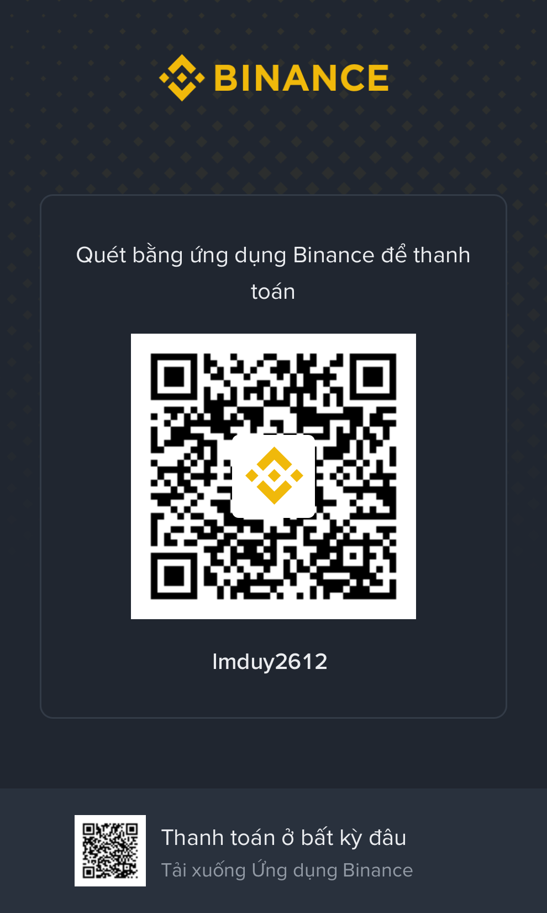

# ⚡ Duy Luong (`lmduy2612`)
### **Agentic Workflow Architect & Multi-Agent Coding Commander**
*Zero-Execution Multi-Agent Squads • 5-Layer Automated Quality Gates • 330+ Agent-Shipped PRs • Live Production Ecosystems*

  

---

## 🎯 About Me: Commanding Autonomous AI Coding Fleets

I am an **Agentic Workflow Architect & Multi-Agent Coding Orchestrator** (active on GitHub since 2017). Instead of writing boilerplate code manually line-by-line, I engineer **deterministic AI Software Delivery Flows**—commanding parallel fleets of autonomous coding agents to design, implement, audit, test, and deploy full-scale production ecosystems.

- 👑 **Hierarchical Squad Orchestration (Zero-Execution)**: Designing multi-agent organizations where a **Main Control CTO Agent** decomposes Epics and delegates strictly scoped tasks to **14+ specialized domain subagents** (`Backend`, `Frontend`, `Admin`, `Harvester`, `AI Refinery`, `Code-Reviewer`, `E2E-Gate`) operating in isolated Git worktrees.
- 📜 **Context Engineering & Deterministic Guardrails**: Eliminating LLM hallucination and architectural drift through codified `AGENTS.md` governance, modular `SKILL.md` playbooks, design token contracts, and strict **Zero-Mock Policies**.
- 🛡️ **Automated 5-Layer Verification Gates**: Controlling AI-generated code through an uncompromising pre-merge pipeline: Static Type/Lint checks, Zero-Mock & Design Linters, independent AI Security/Code Review, and 3-viewport Playwright E2E testing against isolated staging databases.
- 🦀 **Autonomous Open-Source Bounty Resolution**: Directing self-healing TDD agent loops (`Git Mechanic`) that ingest brownfield AST graphs, write failing reproduction tests first, and iterate locally until 100% green before opening PRs (**51+ external PRs merged** across Web3 & open-source ecosystems).
- 📍 **Location**: Vietnam 🇻🇳 (Available for Global Remote Agentic Engineering & Technical Partnerships)

---

## 🚀 Live Ecosystems Built via Agent Orchestration

> *Note: Commercial product repositories are private; click the live production links below to explore the deployed platforms.*

| Platform / Ecosystem | Architectural Scope & Agent Workflow | Target Tech Stack | Live Status |
| :--- | :--- | :--- | :---: |
| **[JobNexus AI (`jobnexus.io.vn`)](https://jobnexus.io.vn)** | Flagship multi-industry AI recruitment & anti-ghost-job platform built by a **14-Subagent Squad** (**278+ PRs**, **15,600+ active jobs across 23+ boards**) | Next.js 15, React 19, NestJS 11, PostgreSQL 16, Qdrant 768-dim, Playwright Stealth | 🟢 **[Live Web ↗](https://jobnexus.io.vn)** |
| **[HireDemand (`hiredemand.io.vn`)](https://hiredemand.io.vn)** | Recruitment market & compensation demand intelligence platform tracking skill velocity and hiring heatmaps | React, Vite Dashboard, Node Analytics API, PostgreSQL 16, Redis | 🟢 **[Live Web ↗](https://hiredemand.io.vn)** |
| **[SanDeal / DealNexus (`san-deal.io.vn`)](https://san-deal.io.vn)** | Automated e-commerce deal harvester & affiliate intelligence platform tracking flash sales and price drops | Python FastAPI, Reactive Vite Storefront, Automated Harvester Bots | 🟢 **[Live Web ↗](https://san-deal.io.vn)** |
| **[Git Mechanic & Bounty Fleet](https://github.com/lmduy2612)** | Autonomous brownfield bug resolver & self-healing TDD agent fleet (**51+ verified external PRs merged**) | Rust (Stellar Soroban), TypeScript, Python, AST Graph Ingestion, Pytest/Playwright | 🟢 **51+ Merged PRs** |
| **[Interactive Portfolio (`lmduy2612.github.io`)](https://lmduy2612.github.io)** | Personal Portfolio & Interactive Agent Fleet Command Center Simulator | HTML5, Tailwind CSS, Neural Mesh Canvas, Terminal Engine | 🟢 **[Live Web ↗](https://lmduy2612.github.io)** |

---

## 🛠️ Agentic Control Plane & Target Architecture Matrix

<table>
  <tr>
    <td align="center" width="26%"><b>Agentic Control Plane</b></td>
    <td>
      
      
      
      
      
    </td>
  </tr>
  <tr>
    <td align="center" width="26%"><b>5-Layer Quality Gates</b></td>
    <td>
      
      
      
      
      
    </td>
  </tr>
  <tr>
    <td align="center" width="26%"><b>Target Backend & Data</b></td>
    <td>
      
      
      
      
      
    </td>
  </tr>
  <tr>
    <td align="center" width="26%"><b>Target Frontend & Web</b></td>
    <td>
      
      
      
      
      
    </td>
  </tr>
  <tr>
    <td align="center" width="26%"><b>Web3 & Smart Contracts</b></td>
    <td>
      
      
      
      
      
    </td>
  </tr>
</table>

---

## 📊 Open-Source Issue Resolution & Engineering Analytics

| 🤖 Total Agent PRs | 🎯 External Bounties | 🟢 CI & E2E Pass Rate | 🛡️ Quality Governance | 🌐 Ecosystems Built / Impacted |
| :---: | :---: | :---: | :---: | :---: |
| **330+ Shipped** | **51+ Merged PRs** | **100% Green CI** | **5-Layer Zero-Mock Gate** | **4 Live Platforms + 12+ OSS Repos** |

 

### 🗺️ Open-Source Bounty Impact Breakdown (`Git Mechanic Agent`)

| Open-Source Organization / Repo | Resolved PRs / Issues | Core Verification Scope | CI & Merge Status |
| :--- | :---: | :--- | :---: |
| **[Heliobond / Frontend](https://github.com/Heliobond/frontend)** | **18+ PRs** | Next.js 15, Stellar Soroban, Playwright E2E, WCAG 2.2 a11y, CSP Nonce | 🟢 100% Passing CI |
| **[ChainLearn / Smart Contracts & Backend](https://github.com/ChainLearnOfficial/chainlearn-contracts)** | **16+ PRs** | Soroban Rust Contracts, Auth Checks, Pause State Security, Learn Token | 🟢 100% Passing CI |
| **[Meet-hybrid / Soroban-Forge](https://github.com/Meet-hybrid/soroban-forge)** | **8+ PRs** | Multi-Sig Rotation, Escrow Keepers, Linear Vesting Schedules | 🟢 100% Passing CI |
| **[gear5labs / Chenpilot-Client](https://github.com/gear5labs/chenpilot-client)** | **2+ PRs** | Message Race Condition, Syntax Highlighting UI | 🟢 Merged & Paid |
| **[Vellar-Wallet / Vellar-SDK](https://github.com/Vellar-Wallet/vellar-sdk)** | **2+ PRs** | CI Push Triggers, Contrib Test Import Paths | 🟢 Resolved |
| **[blockchain-maxis / Signet](https://github.com/blockchain-maxis/signet)** | **1+ PR** | Soroban Doc Comments, Build State Validation | 🟢 Merged & Paid |
| **[Inferara / Soroban-Security-Rules](https://github.com/Inferara/soroban-security-rules)** | **1+ PR** | Admin Persistence & Security Invariant Guards | 🟢 Merged |

 

 

---

## 🏆 Highlighted Open-Source PRs (Verified by `Git Mechanic`)

| Repository / Issue | Problem Solved | Autonomous Agent Fix & Verification | Status |
| :--- | :--- | :--- | :---: |
| **[Heliobond/frontend#722](https://github.com/Heliobond/frontend/pull/776)** | CSP Nonce regex failure & Accessibility scan | Updated regex to support valid Base64 characters (`+`, `/`, `=`) & minimal lockfile diff | 🟢 **100% CI Green** |
| **[Heliobond/frontend#720](https://github.com/Heliobond/frontend/pull/766)** | Quickstart plain-HTTP RPC & passphrase | Replaced hard-coded `allowHttp:false` with `allowHttpFor(RPC_URL)` & dynamic network passphrases | 🟢 **100% CI Green** |
| **[Heliobond/frontend#721](https://github.com/Heliobond/frontend/pull/769)** | Port collision in E2E production specs | Dynamic port isolation & disabled `reuseExistingServer` in Playwright configs | 🟢 **100% CI Green** |
| **[Heliobond/frontend#717](https://github.com/Heliobond/frontend/pull/768)** | Mobile Cumulative Layout Shift (CLS) in Hero | Rendered static LiveHelio SVG in SSR and reserved CSS container dimensions | 🟢 **100% CI Green** |
| **[Heliobond/frontend#719](https://github.com/Heliobond/frontend/pull/779)** | Divergent Contract ABI call assertions | Pinned contract-spec fixtures and validated every Soroban `Contract.call` against ABI | 🟢 **100% CI Green** |

---

## 🛡️ Engineering Standards: The 5-Layer Agent Quality Gate

Every pull request generated by my agent squads must clear 5 deterministic gates before merging:
1. **Static & Type Safety**: `0` ESLint errors and `0` TypeScript (`tsc --noEmit`) errors across affected packages.
2. **Zero-Mock & Design Token Compliance**: No hardcoded mock data in production paths; strict adherence to shared design tokens and layout contracts.
3. **Independent AI Security & Code Review**: Audited by a dedicated reviewer agent for OWASP vulnerabilities, race conditions, and surgical diffs.
4. **3-Viewport Playwright E2E Matrix**: Automated browser verification across Mobile (`390px`), Tablet (`768px`), and Desktop (`1440px`) against real staging databases.
5. **Blue-Green Smoke Verification**: Zero-downtime rollout with automated post-deploy health and smoke checks.

---

## ☕ Sponsor & Donate via Binance Pay

If my open-source solutions, agentic workflows, or platforms saved your team hours of engineering, consider supporting via **Binance Pay**!

<table>
  <tr>
    <td align="center" width="280">
      
       
      <i>Scan directly with your Binance App</i>
    </td>
    <td valign="middle" style="padding-left: 24px;">
      <h3>🟡 Support the Builder via Binance</h3>
      
<b>Binance Pay ID:</b> <code>524179009</code>

      
<b>Direct Supported Tokens:</b> <code>USDT</code> • <code>USDC</code> • <code>XLM</code> • <code>BNB</code> • <code>BTC</code> • <code>ETH</code>

      
<b>Network Options:</b> BEP-20 (BNB Smart Chain) • Stellar Network • TRC-20 • ERC-20

      
<i>Your sponsorship directly funds autonomous agent compute, LLM routing, and continuous open-source engineering!</i>

       
      
      
    </td>
  </tr>
</table>

---

## 🤝 Let's Orchestrate Autonomous Systems Together!

- 🌐 **Interactive Agent Portfolio**: [https://lmduy2612.github.io](https://lmduy2612.github.io)
- 🚀 **Flagship Platform**: [https://jobnexus.io.vn](https://jobnexus.io.vn) • [https://hiredemand.io.vn](https://hiredemand.io.vn) • [https://san-deal.io.vn](https://san-deal.io.vn)
- 📫 **Email**: `lmduy2612@gmail.com`
- 🟡 **Binance Pay ID**: `524179009`

  Orchestrated via <b>Multi-Agent Workflows</b> • © 2026 Duy Luong (<code>@lmduy2612</code>)

